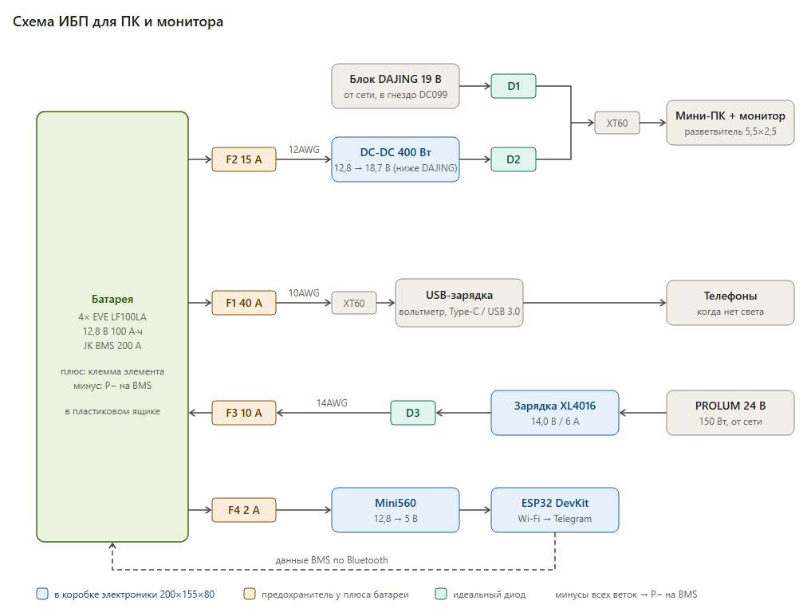
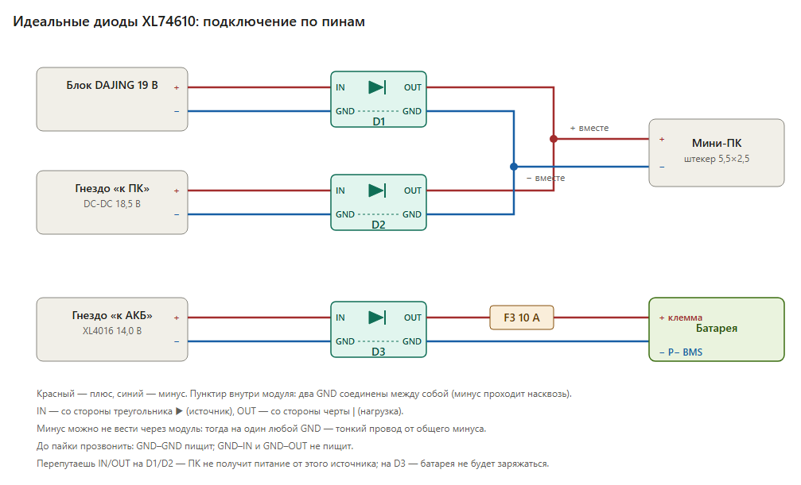
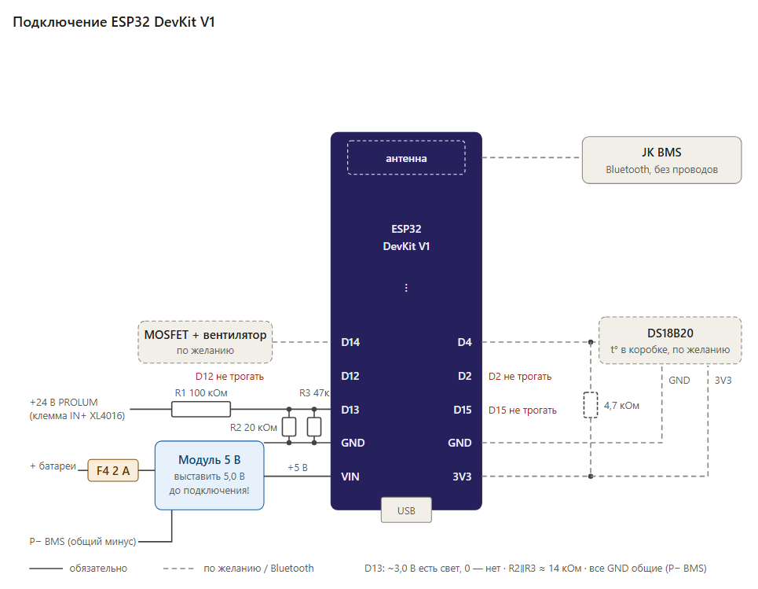
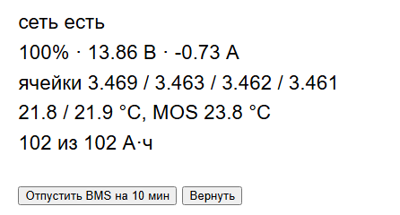
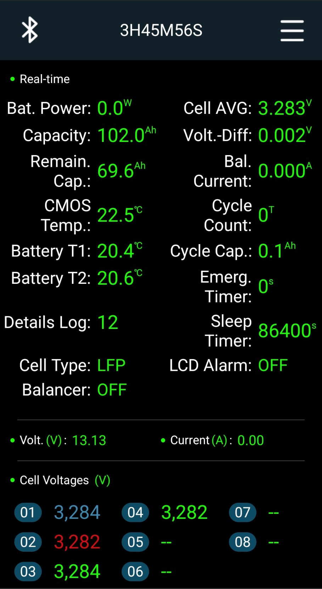
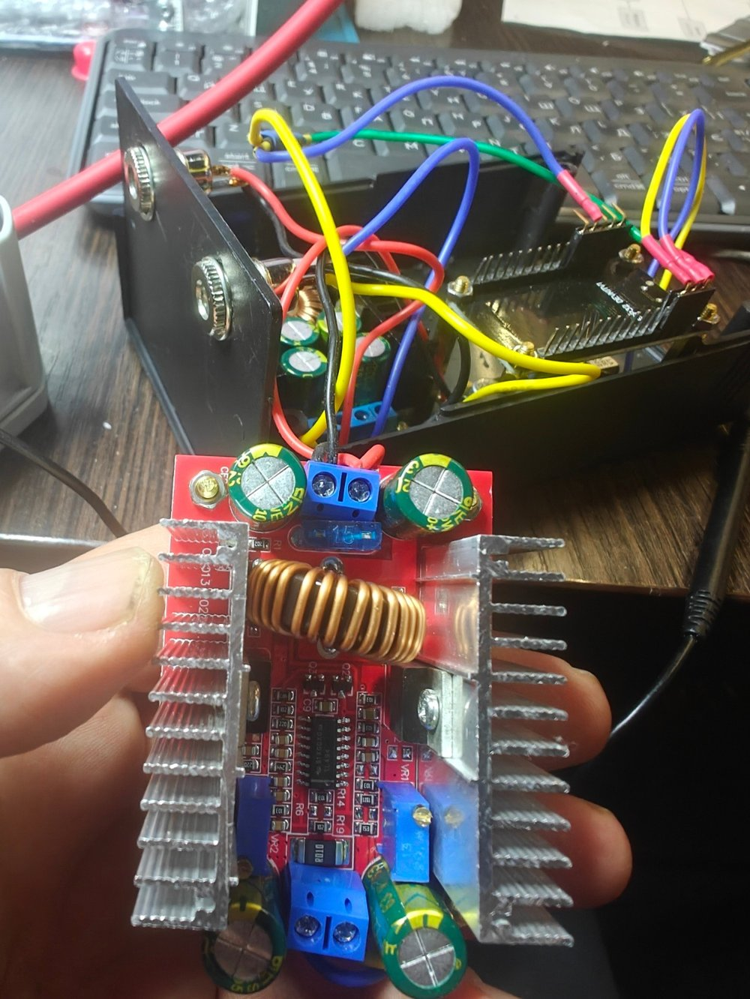
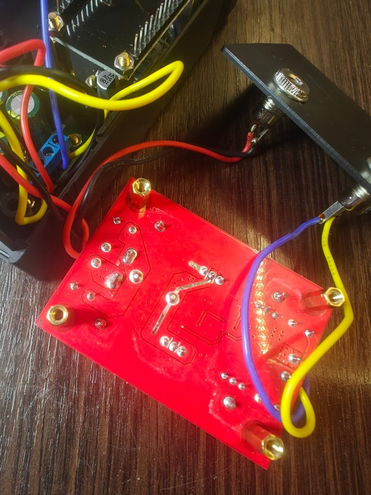
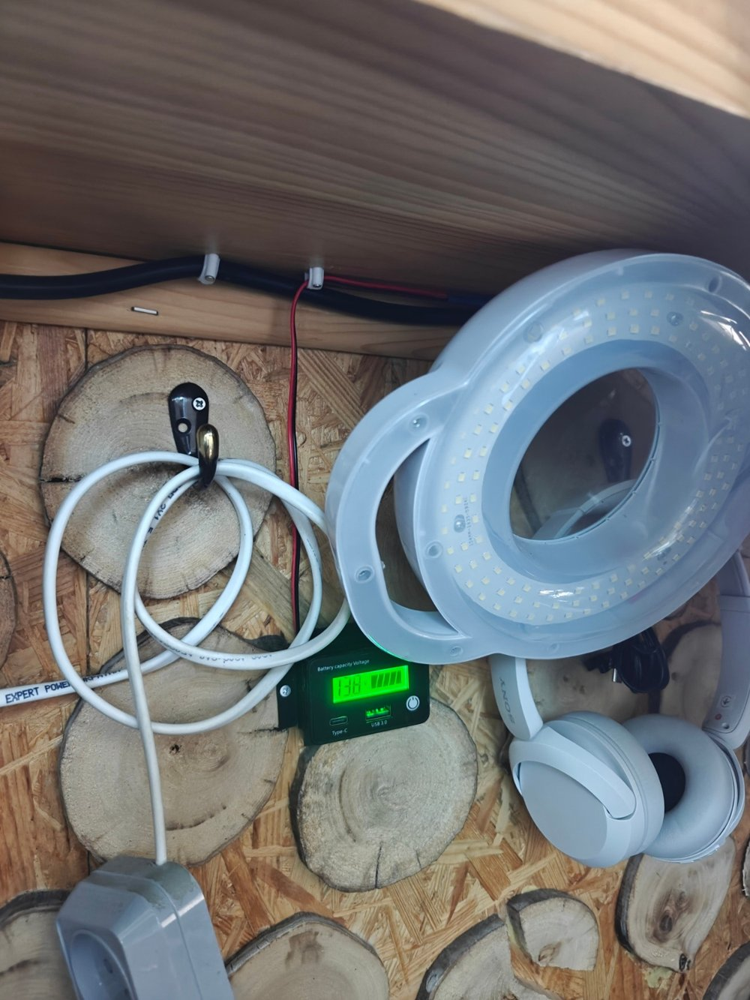

# Самодельный ИБП для мини-ПК и монитора на LiFePO4

Постоянный ток вместо инвертора: батарея 12,8 В → повышающий DC-DC ~18,7 В → ПК и монитор (через разветвитель).
От сети нагрузку питает штатный блок 19 В, переключение через идеальные диоды без провала.
ESP32 читает JK BMS по Bluetooth, шлёт сообщения в Telegram, показывает веб-страницу и даёт ПК сигнал на выключение.

## Схема




```
DAJING 19 В ──D1──┐
                  ├──► ПК + монитор
Батарея ─► DC-DC 400 Вт (~18,7 В) ──D2──┘

PROLUM 24 В ─► XL4016 (CV 14,0 В) ──D3──► батарея
           └─► делитель ─► ESP32 D13 (есть ли сеть)
```

- Батарея: 4× EVE LF100LA (100 А·ч), JK BMS B1A8S20P — настройки в [jk-bms-settings.md](jk-bms-settings.md).
- Идеальные диоды XL74610 — [diodes.html](diodes.html); подключение ESP32 — [esp32.html](esp32.html); общая схема — [schema.html](schema.html); наклейки для печати — [labels.html](labels.html) / [labels.pdf](labels.pdf).


- Напряжение DC-DC держать **ниже** адаптера 19 В — иначе от сети нагрузку берёт батарея и зарядка почти стоит.
- Ограничение тока (CC) на DC-DC поднять: при срабатывании выход проседает до ~11,6 В и монитор мигает.
- У DC-DC нет защиты от КЗ на выходе: подстраивать только с крокодилами и пластиковой отвёрткой.

## Прошивка ESP32 (`firmware/pc_ups`)




- Читает BMS по BLE (протокол JK02_32S, FFE0/FFE1): напряжение, ток, SOC, ячейки, температуры.
- Сообщения в Telegram (только отправка, с очередью): пропала/вернулась сеть, заряд 30 %, выключение ПК при 20 % или ячейке < 3,00 В, потеря связи с BMS.
- Веб: `/` — страница, `/data` — JSON, `/scan` — видимые BLE-устройства, `/diag` — журнал сбоев, `/raw`, `/ble?pause=N`.
- Сторож BLE: нет данных 3 мин — сброс Bluetooth, 10 мин — перезапуск ESP (не чаще 3 раз подряд).
- Обновление по Wi-Fi (ArduinoOTA).

| Веб-страница ESP | Приложение JK BMS |
|---|---|
|  |  |

Сборка:

1. `secrets.example.h` → `secrets.h`, вписать Wi-Fi, бота, OTA-пароль.
2. Библиотека **NimBLE-Arduino 2.3.x** (штатный Bluedroid съедает память, и HTTPS к Telegram не проходит).
3. Ядро esp32 3.3.x, плата ESP32 Dev Module, `PartitionScheme=min_spiffs`, `FlashMode=dio`:

```
arduino-cli compile --fqbn "esp32:esp32:esp32:PartitionScheme=min_spiffs,FlashMode=dio" pc_ups
```

Пин D12 при загрузке должен быть свободен (strapping pin), поэтому сеть заведена на D13.

## Выключение ПК (Windows)

`pc-shutdown.ps1` раз в 15 с читает `http://pc-ups.local/data`; при `"shutdown": true` — `shutdown /s /t 120`, если свет вернулся — отмена. ESP не отвечает — ничего не делает.
Установка в планировщик (PowerShell от администратора):

```
powershell -ExecutionPolicy Bypass -File install-pc-shutdown.ps1
```

## Фото

| DC-DC 400 Вт и коробка электроники | Коробка изнутри | USB-зарядка от батареи |
|---|---|---|
|  |  |  |

## Лицензия

MIT
